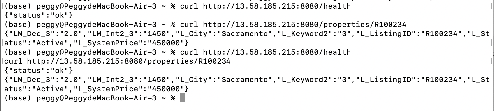
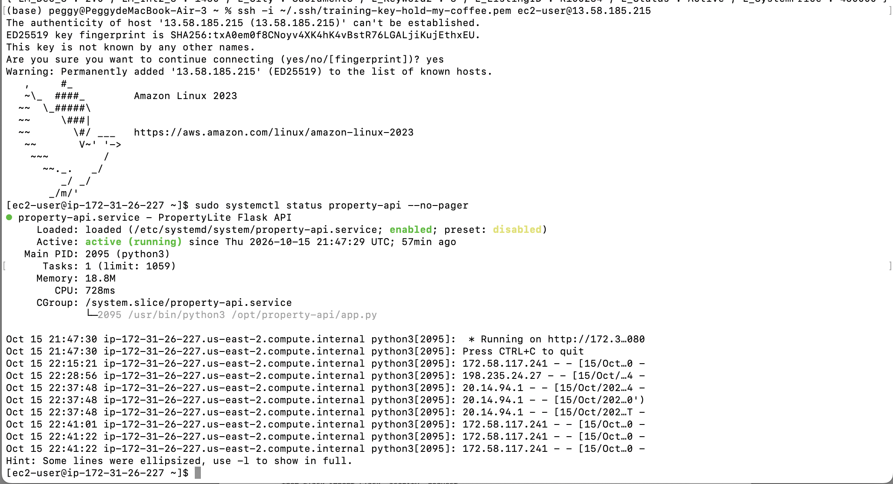
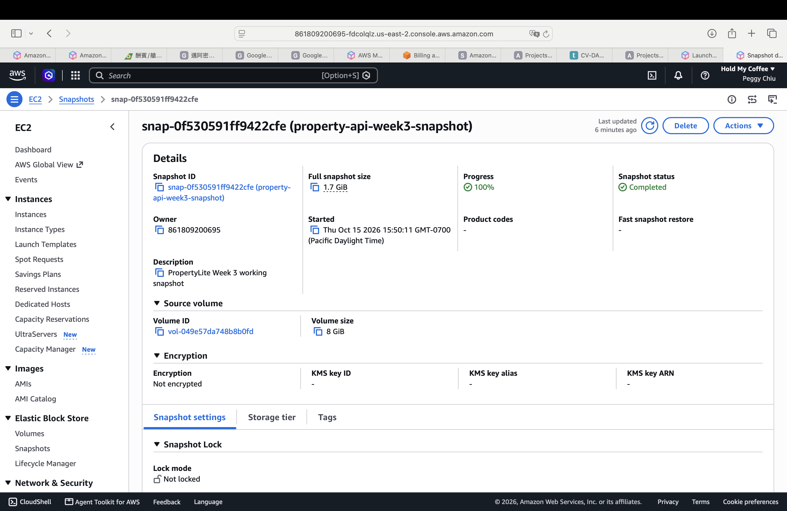

# Week 3 — Deploy PropertyLite to EC2

## Goal

This lab deployed the PropertyLite Flask API from Week 0 to an Amazon EC2 instance. The application runs as a `systemd` service, is reachable through port 8080, and has an EBS snapshot that can be used for recovery.

## Environment

- AWS project: `Hold My Coffee`
- Region: `us-east-2` (Ohio)
- EC2 instance name: `property-api-01`
- AMI: Amazon Linux 2023
- Instance type: `t3.micro`
- Root volume: 8 GiB `gp3`
- Application port: `8080`

## 1. Prepare the SSH key

I downloaded the EC2 key pair as `training-key.pem`, moved it into my SSH directory, and restricted its permissions so SSH would accept it.

```bash
mkdir -p ~/.ssh
mv ~/Downloads/training-key.pem ~/.ssh/training-key-hold-my-coffee.pem
chmod 400 ~/.ssh/training-key-hold-my-coffee.pem
```

The private key must never be committed to GitHub.

## 2. Configure the EC2 instance

I launched one Amazon Linux 2023 instance named `property-api-01` using the `t3.micro` instance type. I selected the downloaded key pair so I could connect with SSH. I used the default VPC and enabled a public IPv4 address so the instance could be reached from my computer.

## 3. Configure network access

I created a security group named `property-api-sg` with these inbound rules:

- SSH/TCP port 22 from **My IP** only, which limits administrative access to my current public IP.
- Custom TCP port 8080 from `0.0.0.0/0`, which makes the PropertyLite API publicly reachable for this lab.

Opening port 8080 to the internet is only for this training exercise. A production deployment should use a load balancer, HTTPS, authentication, and a more restrictive source range.

## 4. Configure storage

I kept one 8 GiB `gp3` EBS root volume. `Delete on termination` was set to `Yes`, so the root volume will be removed automatically when the EC2 instance is terminated and will not continue producing storage charges.

## 5. Bootstrap PropertyLite

I supplied a user-data bootstrap script during launch. The script installed Python and Flask, created `/opt/property-api`, placed the PropertyLite application and sample CSV data there, and created a `systemd` unit named `property-api.service`. The service is enabled so the API starts again automatically after an instance reboot.

## 6. Wait for EC2 health checks

After launch, I waited until the instance state showed `Running` and the system, instance, and EBS status checks all showed `Check passed`. This confirms that the AWS host, operating system, and attached storage were ready before testing the application.

## 7. Verify the API from my computer

I used the instance's public IPv4 address to test the two required endpoints:

```bash
curl http://13.58.185.215:8080/health
curl http://13.58.185.215:8080/properties/R100234
```

The health endpoint returned:

```json
{"status":"ok"}
```

The property endpoint returned the expected `R100234` listing, including Sacramento, Active status, and a system price of 450000.

## 8. Verify the service through SSH

I connected to the instance and checked the service:

```bash
ssh -i ~/.ssh/training-key-hold-my-coffee.pem ec2-user@13.58.185.215
sudo systemctl status property-api --no-pager
```

The result showed `active (running)`, confirming that PropertyLite was running under `systemd` rather than only in my local terminal.

## 9. Create an EBS snapshot

I created the snapshot `property-api-week3-snapshot` from the instance's root EBS volume and waited until its status became `Completed`. The snapshot is a point-in-time backup that can be used to create a replacement volume if the original volume is lost or damaged.

## 10. Troubleshooting notes

If SSH times out, I would check that the instance is running, use its current public IP, confirm port 22 allows my current IP, and verify that the subnet has internet access. If the API cannot be reached, I would confirm that port 8080 is allowed, inspect `systemctl status property-api`, and review the service logs with:

```bash
sudo journalctl -u property-api --no-pager
```

## 11. Cleanup

After saving the required evidence, the EC2 instance should be terminated and the root EBS volume should be confirmed as deleted. The snapshot should also be deleted when it is no longer required because snapshots consume billable storage.

## Evidence

### Working curl responses



### PropertyLite service running



### EBS snapshot completed


