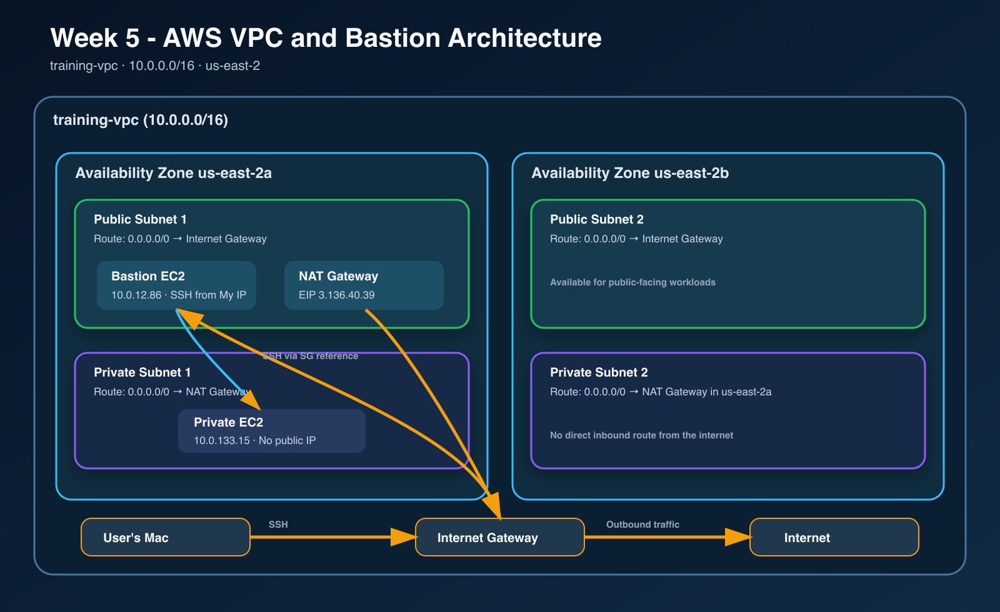

# Week 5 - VPC Networking and Bastion Host

## Goal

This lab builds a custom AWS network with separate public and private subnets. Administrative access to the private EC2 instance is allowed only through a public bastion host, while outbound internet access from private subnets uses a NAT Gateway.

## Architecture



## Environment

- Region: `us-east-2` (Ohio)
- VPC: `training-vpc`
- VPC CIDR: `10.0.0.0/16`
- Availability Zones: `us-east-2a` and `us-east-2b`
- Public subnets: 2
- Private subnets: 2
- Internet Gateway: `training-igw`
- NAT Gateway: one Zonal NAT Gateway in the first public subnet

## 1. Build the custom VPC

I used the VPC and more workflow to create `training-vpc` with two public subnets and two private subnets across two Availability Zones. DNS resolution and DNS hostnames are enabled.

The public route table sends `0.0.0.0/0` to the Internet Gateway. Both private route tables send `0.0.0.0/0` to the same NAT Gateway. This keeps private instances from accepting direct internet connections while still allowing outbound traffic.

## 2. Configure the NAT Gateway

The initial VPC workflow created two Zonal NAT Gateways. To match the training design and avoid paying for an unnecessary second gateway, I changed the second private route table to use the first NAT Gateway, deleted the second NAT Gateway, and released its unused Elastic IP.

The retained NAT Gateway uses Elastic IP `3.136.40.39`.

## 3. Create the bastion host

I launched `training-bastion` in `training-subnet-public1-us-east-2a`:

- Instance type: `t3.micro`
- Operating system: Amazon Linux 2023
- Public IPv4 address: `18.191.162.89`
- Private IPv4 address: `10.0.12.86`
- Security group: `training-bastion-sg`
- Inbound SSH: TCP port 22 from my current public IP `/32` only

The bastion has a public IP and a route through the Internet Gateway, so it is the controlled entry point into the VPC.

## 4. Create the private instance

I launched `training-private` in `training-subnet-private1-us-east-2a`:

- Instance type: `t3.micro`
- Operating system: Amazon Linux 2023
- Private IPv4 address: `10.0.133.15`
- Public IPv4 address: none
- Security group: `training-private-sg`
- Inbound SSH: TCP port 22 from `training-bastion-sg` only

The private security group references the bastion security group rather than an IP address. This means an instance must be attached to `training-bastion-sg` before it can initiate SSH traffic to the private instance.

## 5. Verify the bastion traffic path

I kept the private key on my Mac and used SSH agent forwarding so it was never copied onto the bastion:

```bash
ssh-add ~/.ssh/training-key-hold-my-coffee.pem
ssh -A -i ~/.ssh/training-key-hold-my-coffee.pem ec2-user@18.191.162.89
```

From the bastion, I connected to the private address:

```bash
ssh ec2-user@10.0.133.15
```

On the private instance, the verification commands returned its expected hostname and IP:

```text
$ hostname
ip-10-0-133-15.us-east-2.compute.internal

$ hostname -I
10.0.133.15
```

This verifies the path:

```text
Mac -> Internet Gateway -> public subnet -> bastion -> private subnet -> private EC2
```

## 6. Verify private outbound internet access

From the private instance, I ran the following commands to confirm that outbound traffic crossed the NAT Gateway:

```bash
curl -s https://checkip.amazonaws.com
sudo dnf makecache
```

The public-IP check returned the NAT Gateway Elastic IP:

```text
3.136.40.39
```

The package metadata request reached both Amazon Linux 2023 repositories and finished with:

```text
Metadata cache created.
```

This verifies that the private instance has outbound internet access through its private route table and the NAT Gateway, without having a public IPv4 address of its own.

## Troubleshooting

If SSH from the Mac to the bastion times out, check that the bastion has a public IPv4 address and that `training-bastion-sg` allows port 22 from the current public IP `/32`.

If the bastion cannot reach the private instance, check that `training-private-sg` allows SSH from `training-bastion-sg`, not from a public IP, and confirm that both instances are in `training-vpc`.

If the private instance cannot reach the internet, check that its subnet is associated with a private route table whose `0.0.0.0/0` route targets the available NAT Gateway. Also confirm that the NAT Gateway is in a public subnet whose route table sends `0.0.0.0/0` to the Internet Gateway.

## Cleanup

After saving evidence and documentation:

1. Terminate `training-private` and `training-bastion`.
2. Delete the NAT Gateway and wait for it to reach `Deleted`.
3. Release the NAT Gateway Elastic IP.
4. Delete `training-vpc` and its remaining network resources.
5. Confirm that no unused Elastic IP or NAT Gateway remains.
